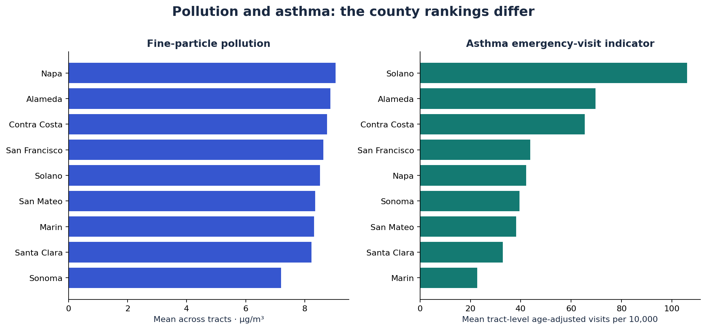
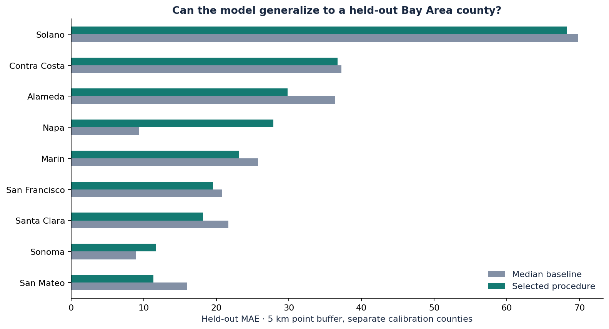
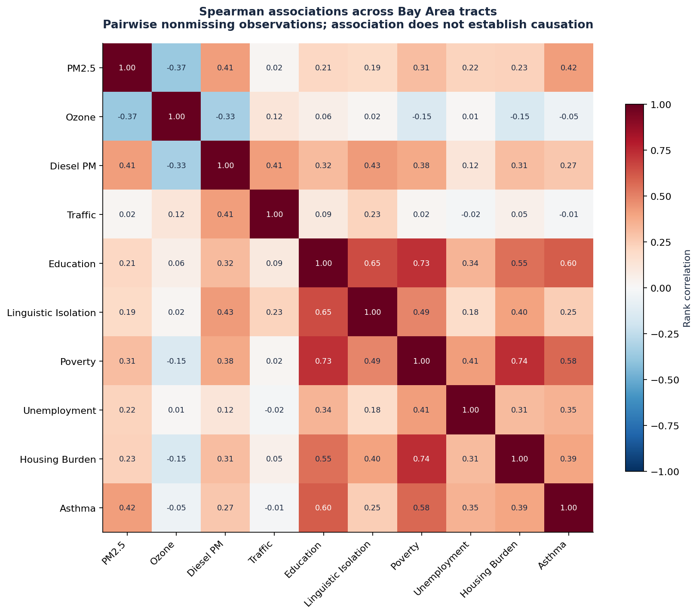
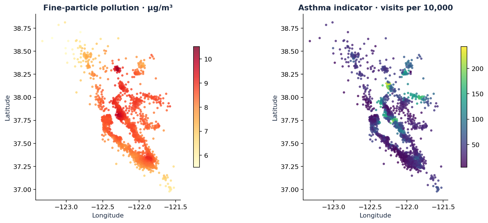
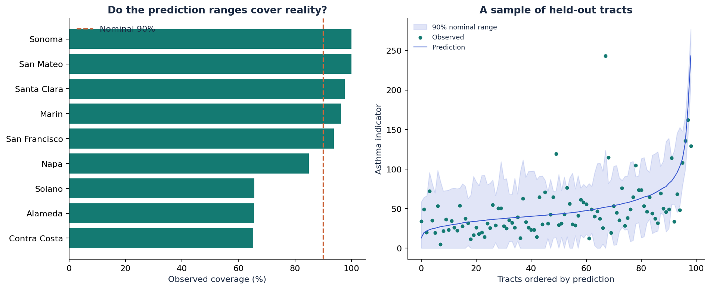

# BayAir

**Understanding pollution and asthma across Bay Area neighborhoods—and testing whether machine learning can connect the two.**

Air pollution varies across the Bay Area. So do asthma-related emergency visits. This project investigates where those patterns overlap, what socioeconomic conditions add to the picture, and whether a model can estimate a neighborhood's asthma indicator when its entire county is excluded from training.

The study covers **1,581 census tracts across nine Bay Area counties**, using the official CalEnviroScreen 4.0 final release. It combines environmental analysis with a reproducible ML experiment designed to expose geographic generalization failures.

[Research notebook](Cal_Bay_Area_PollutionAndHealth_analysis.ipynb) · [Full results](reports/RESULTS.md) · [Modeling code](src/bayair/benchmark.py) · [Evaluation protocol](docs/EVALUATION_PROTOCOL.md)



## What we're trying to understand

1. **Where is pollution higher?** Compare counties and neighborhoods across fine particles, ozone, diesel emissions and broader environmental burden.
2. **Where are asthma emergency visits higher?** Examine the historical asthma indicator and how its geographic pattern differs from pollution.
3. **What information helps explain the pattern?** Compare pollution measurements with socioeconomic indicators such as poverty, education and housing burden.
4. **Does a model work beyond familiar neighborhoods?** Test it on an entire Bay Area county that never participates in fitting or model selection.

All analysis, training, tuning, calibration and testing stays within **Alameda, Contra Costa, Marin, Napa, San Francisco, San Mateo, Santa Clara, Solano and Sonoma**. The source workbook is statewide; the ingestion pipeline filters it to these nine counties before modeling.

## What the data shows

Different measurements have different county leaders:

| Historical measurement | Highest county mean | Value |
|---|---|---:|
| Fine particles, PM2.5 | **Napa** | 9.04 µg/m³ |
| Ozone | **Solano** | 0.04014 ppm |
| Diesel particulate emissions | **San Francisco** | 0.719 tons/year/km² |
| Overall pollution burden | **Alameda** | 37.32 |
| Asthma emergency-visit indicator | **Solano** | 105.95 visits per 10,000 |

These are **unweighted averages across census tracts**, not official aggregated county rates or present-day measurements. Overall pollution burden includes environmental factors beyond air pollution. The asthma indicator measures spatially modeled, age-adjusted emergency visits averaged over 2015–2017; it does **not** measure the percentage of residents with asthma.

The county rankings answer where the measured burden is higher. They do not establish that pollution caused the differences in emergency visits. The [county summary](reports/county_summary.csv) and [data card](DATA_CARD.md) document the measurements and their interpretation.

## What we built

### A verified data pipeline

The original project used a draft-derived CSV with undocumented dates. This rebuild downloads and verifies the **official final-release workbook**, preserves its dictionary and checksums, and produces a Bay Area-only dataset.

The pipeline checks tract identifiers, geographic scope, coordinates, missing labels and invalid measurements. One tract has no asthma label, leaving **1,580 supervised observations**. Missing predictor values are handled inside fitted pipelines; missing target values are never manufactured through imputation.

A [tract-level reconciliation](reports/draft_final_reconciliation.csv) compares the original extract with the official release. Asthma and PM2.5 values agree, while many other environmental values differ. The original CSV is preserved.

→ [Source ingestion and validation](src/bayair/official.py) · [Provenance record](data/provenance.json)

### An evaluation that respects geography

Nearby neighborhoods can share both environmental conditions and information from spatially modeled health indicators. A random split can make prediction look easier than transferring to an unfamiliar area.

For each of nine outer evaluation folds, this project:

1. Holds out one whole county for testing.
2. Reserves two other counties for calibrating prediction ranges.
3. Enforces **5 km centroid buffers** between fitting, calibration and test points.
4. Uses three buffered county-grouped inner folds to select model parameters and model family.
5. Evaluates every labeled tract in the held-out county.

Imputation, scaling and prediction bounds are learned inside the relevant fitting partition. Features exclude the asthma percentile, composites that contain health information, other health outcomes, dates, geographic identifiers and coordinates. Coordinates support spatial separation and maps; they are not model inputs.

→ [Spatial splits](src/bayair/spatial.py) · [Model selection and calibration](src/bayair/advanced.py) · [Saved split manifests](reports/split_manifest.json)

### Model comparisons, explanations and uncertainty checks

The experiment compares a **training-median baseline, log-target Ridge, Extra Trees and histogram gradient boosting** across three feature families:

| Feature family | Inputs |
|---|---|
| Air / traffic | PM2.5, ozone, diesel PM and traffic |
| Socioeconomic | Education, linguistic isolation, poverty, unemployment and housing burden |
| Combined | Thirteen environmental indicators plus the five socioeconomic indicators |

The analysis includes held-out permutation importance, correlation heatmaps, geographic errors, residual plots, poverty slices, feature-shift diagnostics, a shuffled-label control and learning curves.

Prediction ranges use residuals from the reserved calibration counties. Their nominal coverage is 90%; the report measures their actual coverage and width on unfamiliar counties.

→ [Experiment](src/bayair/benchmark.py) · [Every held-out prediction](reports/predictions.csv) · [Hyperparameter searches](reports/hyperparameter_search.csv)

## What the models actually achieved

The primary metric is **macro county MAE**: calculate the mean absolute error in each held-out county, then give the nine counties equal weight. Lower is better. Pooled R² and interval coverage describe all held-out tracts together.

| Procedure | Macro county MAE ↓ | Pooled R² ↑ | Observed coverage of nominal 90% ranges |
|---|---:|---:|---:|
| Training-median baseline | 27.30 | −0.082 | 85.6% |
| Selected model: air / traffic | 27.98 | −0.086 | 85.6% |
| Selected model: socioeconomic | **25.08** | **0.246** | 84.5% |
| Selected model: combined | 27.40 | 0.013 | 83.7% |

The socioeconomic-only procedure performs best in this exploratory comparison. Adding more environmental inputs does not automatically improve geographic generalization. The combined procedure does not beat the median baseline on the primary metric.

The prediction ranges also **under-cover**: a nominal 90% range covers only 83.7% of the combined model's held-out observations. Geographic shift and spatial dependence make a nominal coverage target insufficient by itself.



### A failure we kept in the record

The first official-data experiment exposed extreme extrapolation in a log-target model. We retained that run and added a guard that constrains predictions to the range from zero to the maximum target observed in each fitting partition. The bound never uses calibration or test labels, but it can underestimate an unseen area with a genuinely higher rate.

**That fix followed inspection of the held-out results, so the revised scores are exploratory.** The earlier regional analysis also exposed some of these outcomes. Neither the revision nor the feature comparison should be presented as a fresh confirmatory test. No test tract was discarded to improve the score.

→ [Experiment log](docs/EXPERIMENT_LOG.md) · [Initial failed results](reports/failed_extrapolation/leaderboard.csv) · [Model card](MODEL_CARD.md)

<details>
<summary><strong>More figures: associations, geographic patterns and prediction ranges</strong></summary>

### Associations across neighborhoods



Each cell shows a pairwise rank correlation. Relationships can reflect geography, socioeconomic conditions and other factors; correlation does not establish causation.

### Geographic patterns



### Prediction-range diagnostics



</details>

## Reproduce the study

Use **Python 3.12**. From the repository root:

```bash
python3.12 -m venv .venv
source .venv/bin/activate
python -m pip install -r Bay_Area_Health_and_Pollution_Analysis/requirements-lock.txt

# Train, evaluate, calibrate, and regenerate the report and figures
OMP_NUM_THREADS=1 OPENBLAS_NUM_THREADS=1 python run_bayair.py train

# Run the Python checks
PYTHONPATH=Bay_Area_Health_and_Pollution_Analysis/src python -m pytest Bay_Area_Health_and_Pollution_Analysis/tests -q
```

Open [BayAir.code-workspace](../BayAir.code-workspace) in VS Code, select `.venv`, then use **Run and Debug → BayAir: train + evaluate**. Open the [notebook](Cal_Bay_Area_PollutionAndHealth_analysis.ipynb) with the same kernel and select **Run All**.

The verified processed data and generated evidence are included, so the experiment can run without downloading the workbook again. To verify or rebuild the source snapshot, run `python run_bayair.py fetch-official`. The downloader rejects an unexpected source checksum.

The source-checkout launcher works without installing the package itself. An editable package install is also available through `pyproject.toml`. On Windows, use `.venv\Scripts\Activate.ps1` and select `.venv\Scripts\python.exe`; the supplied workspace paths target macOS.

### Batch inference

```bash
python run_bayair.py predict \
  --input Bay_Area_Health_and_Pollution_Analysis/examples/tract_features.csv \
  --output Bay_Area_Health_and_Pollution_Analysis/artifacts/official/example_predictions.csv
```

Outputs include the estimate, nominal prediction range, missing-feature count and a flag for measurements outside individual fitting-feature ranges. These checks do not detect every form of distribution shift. The final artifact reserves two counties for calibration and has no fresh independent test set. Only load trusted local joblib files.

## Evidence and project structure

```text
Bay_Area_Health_and_Pollution_Analysis/
├── data/                 # Official Bay Area extract, publisher dictionary, provenance
├── src/bayair/           # Data contracts, spatial splits, models, calibration, reporting
├── tests/                # Source, scope, leakage, distances, intervals, inference, evidence
├── reports/              # Results, figures, predictions, calibration errors, split manifests
│   ├── failed_extrapolation/  # Initial robustness failure
│   └── legacy/                # Earlier draft-data study
├── docs/                 # Evaluation protocol, experiment log, verification notes
├── DATA_CARD.md
├── MODEL_CARD.md
└── Cal_Bay_Area_PollutionAndHealth_analysis.ipynb
```

Local verification: **34 Python tests pass**, all **11 notebook code cells execute without errors**, and batch inference works. Offline JavaScript checks cover the report's data binding and controls. CI configuration is included. The original CSV and prior study outputs remain available for comparison.

The existing HTML explorer remains in `reports/index.html`; the notebook, figures and saved evidence are the main entry points for reviewing the research.

## What this study can support

This is a study of **historical, neighborhood-level associations and ML reliability**. It does not establish pollution's causal effect, diagnose an individual, forecast future asthma or validate a public-health decision system.

There are only nine counties. Health labels are spatially modeled. A 5 km centroid buffer cannot guarantee independent observations or separation of tract boundaries. County-resampled stability ranges are descriptive because outer training folds overlap. Standard split-conformal guarantees require assumptions that geographic shift can violate.

The next research priorities are to investigate the remaining county-level failures, understand calibration under geographic shift, and evaluate any revised model on genuinely new observations. The current results provide a reproducible starting point for those questions.

## References

- [California Open Data: official CES 4.0 results and dictionary](https://publish.data.ca.gov/dataset/calenviroscreen-4-0/resource/9a90474a-3912-4955-9552-457ee41cea51)
- [OEHHA: asthma indicator methodology](https://oehha.ca.gov/calenviroscreen/indicator/asthma)
- [scikit-learn: grouped cross-validation](https://scikit-learn.org/stable/modules/cross_validation.html)
- [Angelopoulos & Bates: A Gentle Introduction to Conformal Prediction](https://arxiv.org/abs/2107.07511)
- [Barber et al.: Conformal Prediction Beyond Exchangeability](https://arxiv.org/abs/2202.13415)
